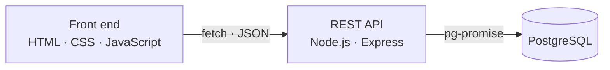
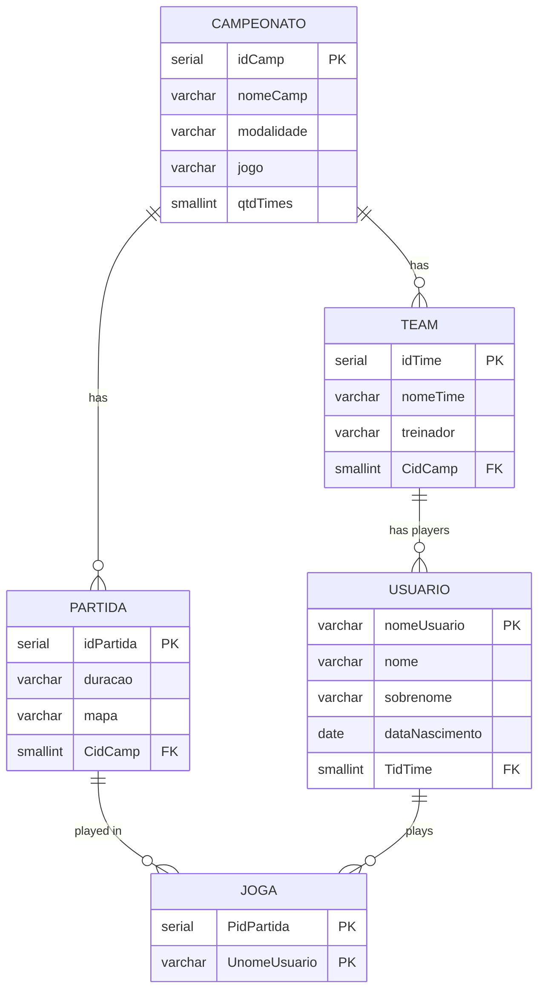

# e-Coliseu — e-sports championship manager

A full-stack web app to manage e-sports championships: championships, teams, players, matches and who played each match. Built as the final project for the Database course at UFMG, with a REST API in Node.js and Express, a PostgreSQL database and a vanilla HTML/CSS/JavaScript front end.

## Architecture



The API follows a layered structure: **routes** handle HTTP, **services** apply the business rules and **data** modules run the SQL queries.

## Data model



Foreign keys use `ON UPDATE CASCADE`; deleting a championship removes its matches and unlinks its teams (`SET NULL`). Schema: [`database/create.sql`](database/create.sql). Sample data: [`database/insertion.sql`](database/insertion.sql).

## API

| Resource | Endpoints |
|---|---|
| Championships | `GET /camps` · `GET /camps/:id` · `POST /camps` · `PUT /camps/:id` · `DELETE /camps/:id` |
| Teams | `GET /times` · `GET /times/:id` · `POST /times` · `PUT /times/:id` · `DELETE /times/:id` |
| Players | `GET /usuario` · `GET /usuario/:id` · `POST /usuario` · `PUT /usuario/:id` · `DELETE /usuario/:id` |
| Matches | `GET /partida` · `GET /partida/:id` · `POST /partida` · `PUT /partida/:id` · `DELETE /partida/:id` |
| Match participation | `GET /jogo` · `GET /jogo/:id` · `POST /jogo` · `DELETE /jogo/:id` |

Errors are returned as JSON with a matching status code: `404` when a record does not exist, `409` for duplicates and `400` for invalid data (missing required fields, unknown foreign keys or malformed values).

Request and response bodies are JSON with lowercase field names, for example:

```bash
curl -X POST http://localhost:3000/camps \
  -H 'Content-Type: application/json' \
  -d '{"idcamp":10,"nomecamp":"Spring Cup","modalidade":"5x5","jogo":"Valorant","qtdtimes":8}'
```

## Run locally

Requirements: Node.js 20.6+ and PostgreSQL (or Docker).

**1. Database**

With Docker, run this from the repository root. It creates the database and loads the schema and sample data automatically (on PowerShell, replace `$(pwd)` with `${PWD}`):

```bash
docker run -d --name ecoliseu-db -p 5432:5432 \
  -e POSTGRES_PASSWORD=change-me -e POSTGRES_DB=tp_bd \
  -v "$(pwd)/database:/docker-entrypoint-initdb.d:ro" postgres:16
```

With a local PostgreSQL, create a database named `tp_bd` and run `database/create.sql` and then `database/insertion.sql`.

**2. API**

```bash
cd api
cp .env.example .env    # set DB_PASSWORD (and the other values if needed)
npm install
npm start
```

The API listens on `http://localhost:3000`.

**3. Front end**

Open `frontEnd/index.html` in the browser, or serve the folder with any static server (for example the VS Code Live Server extension).

## Project structure

```
api/
├── server/
│   ├── server.js        # Express app and route registration
│   ├── route/           # HTTP routes per resource
│   ├── service/         # business rules
│   ├── data/            # SQL queries
│   └── infra/database.js
└── .env.example
database/                # schema and sample data
frontEnd/                # HTML, CSS (SCSS) and JavaScript
artefatos_engenharia_de_software/   # requirements document, UML diagrams and Figma prototype
```

## Software engineering artifacts

The project was designed before it was coded: [`artefatos_engenharia_de_software/`](artefatos_engenharia_de_software) holds the requirements document, class, use-case and activity diagrams (Astah) and the Figma prototype.

## Limitations

This is an academic project:

- IDs are provided by the client instead of being generated by the database.
- There is no authentication.
- There are no automated tests yet.
- The interface and database names are in Portuguese, as required by the course.

## Author

Arthur Nolasco — [github.com/arthurnolasco](https://github.com/arthurnolasco)
